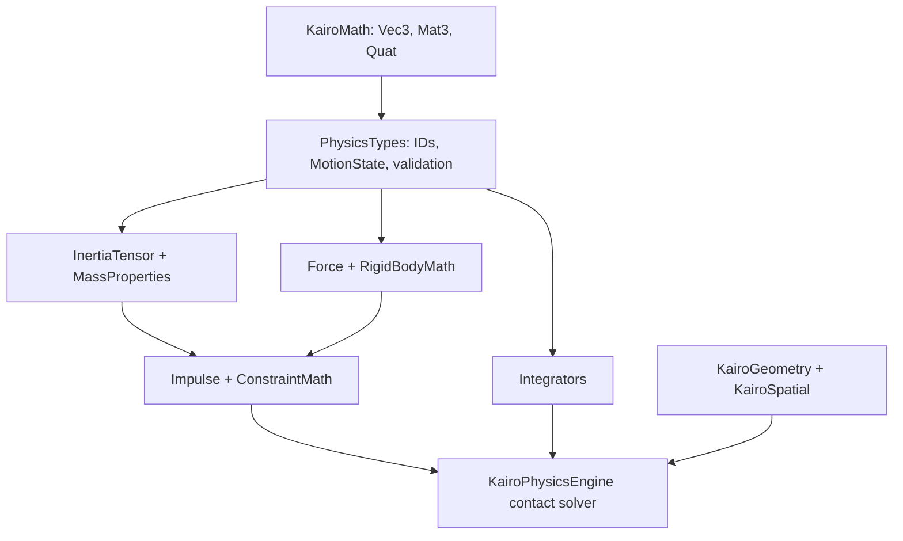

# From vectors to rigid-body dynamics — KairoPhysicsMath

This is a narrative companion to [the linked source-reading order](SOURCE_READING_ORDER.md). It explains the *implemented* formulas and their ownership boundaries. It is not a claim of physical exactness or of a fully implemented simulation engine.

## 1. What this layer is and is not

A game-engine physics update must answer several distinct questions. Geometry represents shapes; broadphase finds plausible pairs; narrowphase computes contacts; a solver changes momenta; an integrator advances state. This repository solves **mathematical subproblems** shared by those stages, but deliberately does not own a collision world, spatial acceleration tree, game-engine object lifecycle or renderer.

**Units and conventions:** position in meters, time in seconds, mass in kilograms, angular velocity in radians/second, force in newtons, torque in newton-meters, moment of inertia in kg·m². The repository uses right-handed coordinates and a local Y-axis capsule. Here a zero inverse mass denotes an immovable body; it is not permission to divide by zero. Check [PhysicsTypes.cppm](../PhysicsTypes.cppm) first.

## 2. Why mass and inverse mass both exist

Newton's second law is `F=m*a`, so a dynamic object's acceleration is `F/m`. Solvers evaluate inverse mass frequently; storing `1/m` saves a division and makes the static case explicit: `inverseMass=0` means applied impulses should not affect linear velocity.

In [MassProperties.cppm](../MassProperties.cppm), `SphereMassProperties(radius,density)` computes `volume = 4*pi*r^3/3` and `mass = density*volume`. For a uniform solid sphere, inertia about its center is `I=2*m*r^2/5` on every axis. Boxes use **half-extents**, so their full lengths are twice the input; for example `Ixx = m*(hy^2+hz^2)/3`. Capsule mass uses cylinder plus spherical volume, with an approximate capsule inertia model defined in [InertiaTensor.cppm](../InertiaTensor.cppm).

A nonobvious constraint: `MakeMassProperties` computes an inverse using `InverseDiagonalInertia`. That helper reads the diagonal components and assumes a principal-axis frame. Feeding it a fully coupled arbitrary 3×3 tensor would silently lose off-diagonal effects. Compound bodies calculate a mass-weighted center and shift each child inertia using the parallel-axis theorem, `I_shifted = I_local + m*(|d|²*Identity - d*dᵀ)`; all children must be expressed in a common local frame.

## 3. Rotating inertia into world space

A body may rotate while its intrinsic local inertia stays fixed. The orientation quaternion produces a rotation matrix `R`. For a local inverse inertia tensor `I_local_inv`, the angular response in world coordinates is

`I_world_inv = R * I_local_inv * transpose(R)`.

This is why angular impulse code consumes a **world-space inverse inertia**, not an unrotated local tensor. The relevant functions are `InverseInertiaWorld` in [InertiaTensor.cppm](../InertiaTensor.cppm) and the velocity/impulse helpers in [RigidBodyMath.cppm](../RigidBodyMath.cppm). A quaternion should be normalized and consistent with KairoMath's multiplication convention before conversion.

## 4. Forces are not impulses

A force acts over a duration. [Force.cppm](../Force.cppm) accumulates forces and torques without immediately changing velocity. When a force `F` acts at world point `p` relative to center of mass `c`, its torque is `(p-c) cross F`. Integrating over `dt` gives the linear velocity increment `delta_v = inverseMass * F * dt`.

An impulse `J` is the integrated effect of force over a short interval, measured in N·s. The same body receives `delta_v = inverseMass*J` **without an extra dt factor**. Applied away from the center, its angular impulse is `(p-c) cross J`. [RigidBodyMath.cppm](../RigidBodyMath.cppm) implements these operations and exposes momentum/kinetic-energy diagnostics. The owning physics world decides when to accumulate forces, solve contacts, apply impulses and clear accumulators.

## 5. Why the contact solver needs angular inertia

Two bodies colliding at an offset point cannot be treated as point masses. Let `n` be the contact normal and `rA/rB` the arms from each body's center of mass. The effective inverse mass along the normal includes

`inverseMassA + inverseMassB + dot(n, cross(I_A_inv*cross(rA,n),rA) + cross(I_B_inv*cross(rB,n),rB))`.

The helper `ContactNormalDenominator` in [Impulse.cppm](../Impulse.cppm) computes that expression. For approaching bodies with signed normal relative speed `v_n < 0`, restitution `e`, and nondegenerate denominator `k`, the normal impulse magnitude is `j=-(1+e)*v_n/k`. Separating bodies receive no collision impulse from that helper.

For friction, the code subtracts normal velocity to obtain tangent velocity, estimates a tangent impulse, and clamps its magnitude. A broader sequential solver typically relates the allowed maximum to friction coefficient and accumulated normal impulse. **These formulas are not a collision detector**: the normal, arms and penetration must come from a separate narrowphase. [Contact.cppm](../Contact.cppm) only validates and stores those records.

## 6. Integrating motion is an approximation

[Integrators.cppm](../Integrators.cppm) contains several explicit choices:

| Method | State update | Main trade-off |
| --- | --- | --- |
| Explicit Euler | `x_next=x+v_old*dt; v_next=v_old+a*dt` | Simple but can add energy for stiff systems |
| Semi-implicit Euler | `v_next=v_old+a*dt; x_next=x+v_next*dt` | Often better behaved for realtime forces |
| Verlet position | `x_next=2*x-x_previous+a*dt²` | Uses previous position as implicit velocity; sensitive to variable dt |
| Midpoint RK2 | Two derivative evaluations | Better local accuracy for smooth scalar autonomous ODEs |
| RK4 | Four derivative evaluations | Higher-order smooth ODE reference, still not a constraint solver |

The two Runge–Kutta helpers accept a **scalar** `y` and derivative `f(y)`; they are not arbitrary multibody integrators or time-dependent `f(t,y)` engines. Quaternion orientation uses a first-order derivative from angular velocity and re-normalizes. None of these operations prevent a penetrated rigid body from tunneling through geometry; collision detection and continuous-collision handling are separate concerns.

## 7. Constraint rows and warm starting

[ConstraintMath.cppm](../ConstraintMath.cppm) evaluates one constraint Jacobian row. The denominator `J*M_inverse*Jᵀ` measures how much motion changes along that constraint for a given impulse. Its reciprocal (when sufficiently nonzero) is the effective mass used in iterative correction.

`BaumgarteBias` changes position error into a bounded velocity correction of the form `beta*error/dt`. This stabilizes penetrations and joints numerically; it is not a physically exact force law. `ClampAccumulatedImpulseDelta` clamps the total cached impulse and returns only the new increment. That distinction is necessary for correct warm starts and bounded unilateral constraints.

## 8. Reading a real simulation path

A simple dynamic sphere with radius `r` and density `rho` starts with `SphereMassProperties(r,rho)`. The physics world stores its `MotionState` and local inverse inertia. Gravity creates `m*g`; the integration step obtains acceleration `F/m` and advances pose. When narrowphase returns a contact, the solver reads the world-space inverse inertia, evaluates effective mass, applies impulses at the contact point, and updates velocity. Rendering then consumes the resulting transform from the world, **not** an internal state of KairoPhysicsMath.

## 9. Tests and reproducibility

[PhysicsMathTests.cpp](../tests/PhysicsMathTests.cpp) contains seven Catch2 test cases covering mass, inertia, forces, integration, impulses/constraints, contacts and invalid input. [CertificationTests.cpp](../tests/CertificationTests.cpp) adds scale-range, quaternion normalization and center-of-mass impulse checks. These are focused numerical tests, not native engine benchmarks.

The [CMake configuration](../CMakeLists.txt) links KairoMath and can build the Catch2 executables at the top level. It prefers an explicit or sibling KairoMath source before the pinned fallback revision. To build locally, use a C++23-module-capable toolchain and run CTest; no such build was executed as part of this teaching documentation pass.

## 10. Exercises that turn formulas into understanding

First, derive sphere and box mass/inertia by hand and compare to the code. Then rotate a diagonal inverse inertia tensor and show why a world-space contact has a different angular response. Next compare explicit and semi-implicit Euler for a spring over several timesteps, reporting energy drift rather than just position. Finally, construct a contact between two spheres, compute the denominator and normal impulse manually, and test the result against `ComputeNormalImpulseMagnitude` for approaching and separating motion.

For every exercise identify the **units**, the **state owner**, the **mathematical assumption**, the **caller**, the **consumer**, and the **test** that verifies it.
